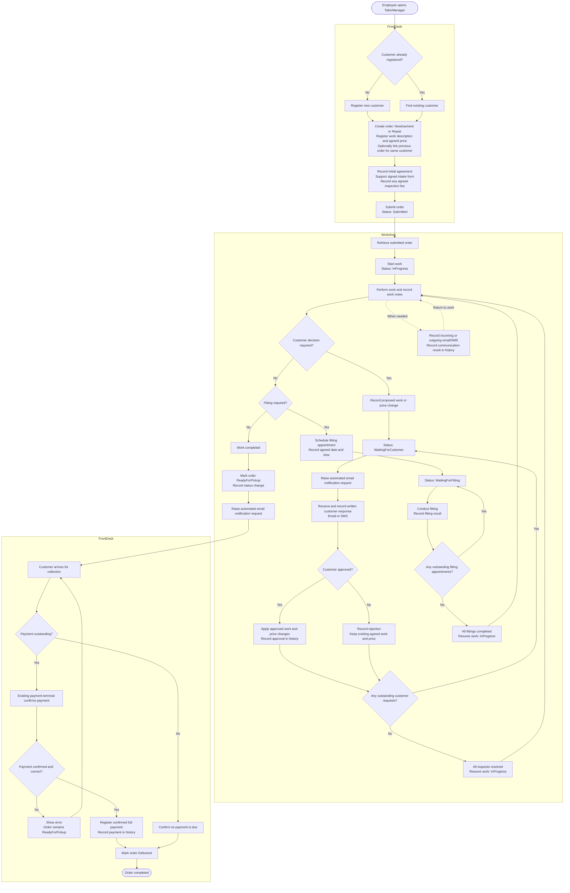
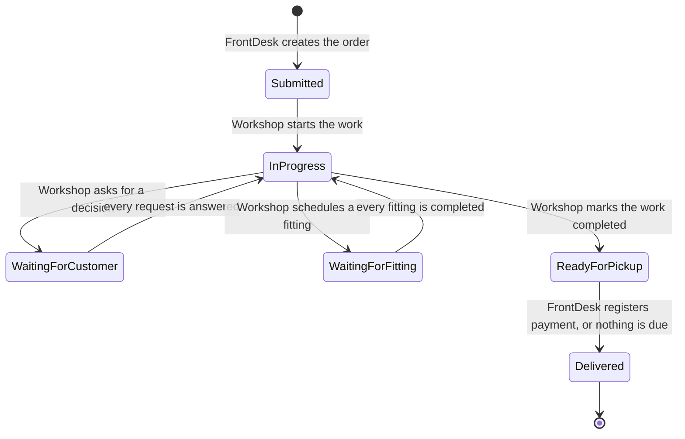
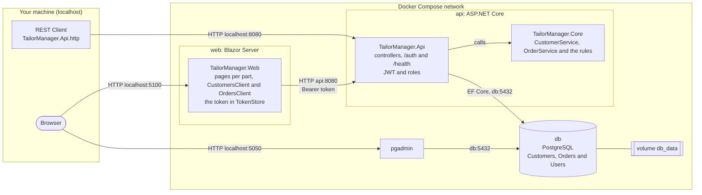
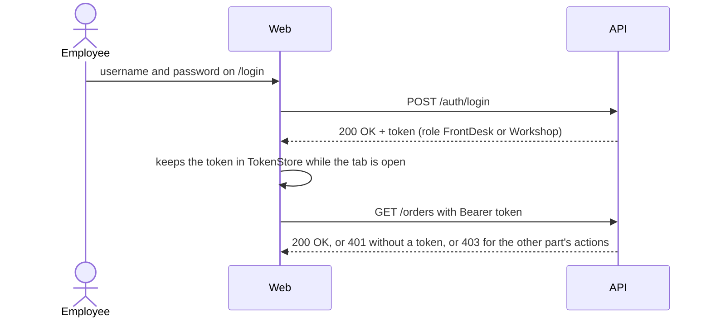

# Specification – TailorManager

## 1 The project in my own words

TailorManager is an order management system for tailoring businesses that handle new garment orders and repairs.

Employees can register customers and orders, track workshop progress, schedule fittings, communicate with customers, register payments and see the complete history of each order.

Delivered as a .NET Web API and a Blazor Server website for the employees, with PostgreSQL in Docker Compose, from a GitHub repo.

Categories: Core, API, Web, EF, Docker, Workflows, Docs, Mermaid

## 2 Requirements

Parts of the system:

- FrontDesk (registers incoming orders, handles payment and delivers completed orders)
- Workshop (processes orders, schedules fittings and communicates with customers)

Main flow (FrontDesk): an employee registers or finds a customer, creates an order with its work description and agreed price, submits it to the Workshop, and later registers payment, or confirms that nothing is due, before delivering the order.

Main flow (Workshop): an employee starts a submitted order, records the work, asks for written customer approval before changing the agreed work or price, schedules fittings when needed, and marks the order as ready for pickup when it is completed.

Frontend: the main flow can be done in the browser, by FrontDesk (Search, Ready for pickup) and by Workshop (Orders)

Login: employees register and log in, and each part can only do its own actions

Core (MUST):

- (FrontDesk) Register a customer with name, phone number, email and address
- (FrontDesk) Find a customer by name, phone number or email
- (FrontDesk) Create an order for a new garment or a repair, with a work description and an agreed price
- (FrontDesk) Record the customer's initial agreement, with a reference to the signed intake form
- (FrontDesk) Record the customer's written agreement to a possible inspection fee
- (FrontDesk) Link an order to an earlier order from the same customer
- (FrontDesk → Workshop) A new order is submitted, so the Workshop sees the customer and the work
- (Workshop) List orders by status or customer, and open an order with its history
- (Workshop) Start a submitted order
- (Workshop) Record the work performed
- (Workshop) Ask the customer to approve a change to the agreed work or price
- (Workshop) Record the customer's written approval or rejection
- (Workshop) Schedule a fitting with an agreed date and time
- (Workshop) Record the result of a fitting
- (Workshop) Record incoming and outgoing email and SMS
- (Workshop → FrontDesk) Mark a completed order as ready for pickup
- (FrontDesk) Register a confirmed full payment, which delivers the order
- (FrontDesk) Deliver an order with nothing to pay

Rules:

- An order follows Submitted → InProgress → ReadyForPickup → Delivered, with WaitingForCustomer and WaitingForFitting as temporary states that return to InProgress when all outstanding requests or appointments of that type are resolved.
- An order in WaitingForCustomer has at least one pending customer decision request.
- An order in WaitingForFitting has at least one scheduled fitting that is not completed.
- Every change to the agreed work or price requires written customer approval, linked to the specific change request.
- A rejected change does not modify the agreed work or price.
- An approved price adjustment changes CurrentAgreedPrice only after the written approval is recorded.
- An answered decision request and a completed fitting cannot be answered or completed again.
- An order cannot be marked Delivered while it has an outstanding balance. Full payment must be registered first.
- An order with no outstanding balance can be marked Delivered without a payment.
- Incorrect payment amounts, missing or duplicate transaction references and invalid payment registrations are rejected without changing the order or its status. Core only accepts payments that are already confirmed outside Core.
- Linked orders must belong to the same customer.
- Failed communication does not change the order status, but the failure is recorded in the history.
- An automated notification request is raised when an order enters WaitingForCustomer or ReadyForPickup. It is a NotificationRequested entry in the history, and sending it happens outside Core.
- Delivered orders cannot be reopened. Reclamation work is registered as a new order linked to the original order.
- The order history is append-only: earlier activities are never overwritten or deleted.

Later / bonus (NOT NOW):

- Free reclamation work when valid reclamation grounds are established
- Charging the inspection fee (only when the customer agreed in writing at intake, no valid reclamation grounds are established, and no other work is performed)
- Partial payments and deposits
- Order cancellation and cancellation fees
- Customer-facing order tracking
- Inventory and material management
- Accounting integration
- Direct email and SMS provider integrations
- Payment terminal integration
- Advanced reporting and business analytics

## 3 Flow



All relevant order activities are recorded in an append-only history: order creation, initial approvals, status changes, work notes, customer decisions, fittings, communication, price adjustments, notification requests and payments. The history references the detailed records instead of copying their contents.

### Data

~~~mermaid
erDiagram
    Customer ||..o{ Order : "CustomerId (not a foreign key)"
    Customer {
        guid Id
        string Name
    }
    Order {
        guid Id
        guid CustomerId
        string WorkDescription
        string Status
    }
    User {
        guid Id
        string Username
        string PasswordHash
        string Role
        string FirstName
        string LastName
    }
~~~

Users is its own table. The history stores the employee's id and display name, so Order has no foreign key to User either.

### Order status

Every arrow is a move that is allowed, and becomes a function in §5. Moves without an arrow are not allowed.



### Architecture

Every part of the system as it runs with Docker Compose. Solid arrows are requests, dotted arrows are dependencies. Start order (depends_on): db, then api when db is healthy, then web.



### Login flow



### Pages and navigation

A customer has no page of its own. FrontDesk searches by name, phone number or email, and the results show the matching customers, each with its orders.

~~~mermaid
flowchart LR
    login["/login<br/>LoginPage"] -- "logged in as FrontDesk" --> fdmenu{{FrontDesk menu}}
    login -- "logged in as Workshop" --> wsmenu{{Workshop menu}}
    register["/register<br/>RegisterPage"] -- "registered" --> login
    fdmenu --> search["/front-desk<br/>FrontDeskSearchPage"]
    search -- "New customer" --> search
    search -- "New order for a customer" --> order["/orders/{id}<br/>OrderDetailsPage"]
    search -- "clicks an order" --> order
    fdmenu --> ready["/front-desk/orders<br/>FrontDeskOrdersPage (ReadyForPickup)"]
    ready -- "clicks an order" --> order
    wsmenu --> wsorders["/workshop/orders<br/>WorkshopOrdersPage"]
    wsorders -- "clicks an order" --> order
    order -- "Back" --> search
    search -- "nothing matches" --> nomatch[/Shows: No customers found/]
    search -- "the API fails" --> error[/Shows: Could not load customers/]
    wsorders -- "the list is empty" --> empty[/Shows: No orders yet/]
    order -- "no token (401)" --> login
~~~

## 4 Interface

| Type | Fields |
| --- | --- |
| Customer | Id (Guid), Name (string), Phone (string), Email (string), Address (string) |
| Order | Id (Guid), CustomerId (Guid), Type (OrderType), WorkDescription (string), InitialAgreedPrice (decimal), ApprovedPriceAdjustments (List<PriceAdjustment>), CurrentAgreedPrice (decimal, calculated), OutstandingBalance (decimal, calculated), Status (OrderStatus), CreatedAt (DateTimeOffset), RelatedOrderId (Guid?), History (List<OrderHistoryEntry>), Fittings (List<FittingAppointment>), CustomerDecisionRequests (List<CustomerDecisionRequest>), CustomerApprovals (List<CustomerApproval>), Communications (List<CommunicationEntry>), Payments (List<Payment>) |
| OrderHistoryEntry | Id (Guid), Type (ActivityType), OccurredAt (DateTimeOffset), ActorId (Guid?), ActorDisplayName (string?), RelatedEntityId (Guid?), Note (string?), FromStatus (OrderStatus?), ToStatus (OrderStatus?) |
| FittingAppointment | Id (Guid), ScheduledAt (DateTimeOffset), CompletedAt (DateTimeOffset?), Outcome (string?) |
| CustomerDecisionRequest | Id (Guid), ProposedWorkChange (string), ProposedPriceAdjustment (decimal?), Status (DecisionStatus), ResponseCommunicationId (Guid?), RespondedAt (DateTimeOffset?) |
| CustomerApproval | Id (Guid), Scope (ApprovalScope), Method (ApprovalMethod), ApprovedAt (DateTimeOffset), RelatedDecisionRequestId (Guid?), CommunicationId (Guid?), DocumentReference (string?), ApprovedAmount (decimal?), ApprovedTerms (string?) |
| PriceAdjustment | Id (Guid), Description (string), Amount (decimal), ApprovedAt (DateTimeOffset), CustomerApprovalId (Guid) |
| CommunicationEntry | Id (Guid), Channel (CommunicationChannel), Direction (CommunicationDirection), Source (CommunicationSource), Content (string), Outcome (CommunicationOutcome), OccurredAt (DateTimeOffset) |
| Payment | Id (Guid), Amount (decimal), ReceivedAt (DateTimeOffset), TransactionReference (string) |

| Enum | Values |
| --- | --- |
| OrderType | NewGarment, Repair |
| OrderStatus | Submitted, InProgress, WaitingForCustomer, WaitingForFitting, ReadyForPickup, Delivered |
| ActivityType | OrderCreated, InitialApprovalRecorded, StatusChanged, WorkNoteAdded, CustomerDecisionRequested, CustomerDecisionRecorded, FittingScheduled, FittingCompleted, CommunicationRecorded, PriceAdjusted, InspectionFeeAgreementRecorded, NotificationRequested, PaymentReceived |
| ApprovalMethod | SignedForm, Email, SMS |
| ApprovalScope | InitialOrder, WorkChange, InspectionFee |
| DecisionStatus | Pending, Approved, Rejected |
| CommunicationChannel | Email, SMS |
| CommunicationDirection | Incoming, Outgoing |
| CommunicationSource | Manual, Automated, Customer |
| CommunicationOutcome | Sent, Received, Failed |

Examples (the values the tests use, in the same order as the parameters of the method, after the ids):

- Customer: "Anna Hansen", "98765432", "anna@example.com", "Storgata 1, 0155 Oslo"
- Order: NewGarment, "Shorten the trousers by 3 cm", 450m, null
- Initial approval: SignedForm, "FORM-1001"
- Inspection fee agreement: 150m, "FORM-1002"
- Work note: "Hem pinned, ready to sew"
- Decision request: "Also take in the waist by 2 cm", 150m
- Fitting: two days after the order is created, at 10:00, with the outcome "The length is right"
- Communication: Email, Incoming, Customer, "Yes, please take in the waist as well.", Received
- Payment: 450m, "TX-1001"
- Employee: "Kari", "Nordmann", shown as "Kari N."

```text
CustomerService

- Customer AddCustomer(string name, string phone, string email, string address)
  → the new customer
  Empty name, phone, email or address: ArgumentException
- IReadOnlyList<Customer> FindCustomers(string searchTerm)
  → customers whose name, phone or email matches
- Customer GetCustomer(Guid customerId)
  → the customer
  Unknown customer: CustomerNotFoundException

OrderService

- Order CreateOrder(Guid customerId, OrderType type, string workDescription, decimal agreedPrice, Guid? relatedOrderId)
  → a new order with status Submitted and a history entry
  Unknown customer: CustomerNotFoundException
  Negative price or empty work description: ArgumentException
  Unknown related order: OrderNotFoundException
  Related order belongs to another customer: InvalidOperationException
- CustomerApproval RecordInitialApproval(Guid orderId, ApprovalMethod method, string? documentReference)
  → records the customer's initial agreement
  Unknown order: OrderNotFoundException
  Signed form without a document reference: ArgumentException
- CustomerApproval RecordInspectionFeeAgreement(Guid orderId, decimal amount, string documentReference)
  → records the written agreement to a possible inspection fee
  Unknown order: OrderNotFoundException
  Negative amount or missing document reference: ArgumentException
- IReadOnlyList<Order> ListOrders(OrderStatus? status, Guid? customerId)
  → the orders that match, all orders when both are null
- Order GetOrder(Guid orderId)
  → the order with its history
  Unknown order: OrderNotFoundException
- Order StartWork(Guid orderId)
  → status Submitted → InProgress, and a history entry
  Unknown order: OrderNotFoundException
  Not Submitted: InvalidOrderStatusException
- Order AddWorkNote(Guid orderId, string note)
  → the note is added to the history
  Unknown order: OrderNotFoundException
  Not InProgress: InvalidOrderStatusException
  Empty note: ArgumentException
- Order RequestCustomerDecision(Guid orderId, string proposedWorkChange, decimal? proposedPriceAdjustment)
  → a pending request, status WaitingForCustomer, and a notification request when entering WaitingForCustomer
  → can add further requests while already WaitingForCustomer, without a new notification request
  → the agreed price is not changed until the request is approved
  Unknown order: OrderNotFoundException
  Not InProgress or WaitingForCustomer: InvalidOrderStatusException
  Empty work change: ArgumentException
- Order RecordCustomerDecision(Guid orderId, Guid requestId, Guid communicationId, bool approved)
  → records the written response, creates a CustomerApproval when approved, applies an approved price adjustment
  → InProgress again when no request is pending
  Unknown order: OrderNotFoundException
  Unknown request: KeyNotFoundException
  No recorded written response: InvalidOperationException
  Request already answered: InvalidOperationException
- Order ScheduleFitting(Guid orderId, DateTimeOffset scheduledAt)
  → a fitting appointment, and status WaitingForFitting
  → can add further appointments while already WaitingForFitting
  Unknown order: OrderNotFoundException
  Not InProgress or WaitingForFitting: InvalidOrderStatusException
  A date before the current time: ArgumentException
- Order CompleteFitting(Guid orderId, Guid fittingId, string outcome)
  → records the outcome
  → InProgress again when every fitting is completed
  Unknown order: OrderNotFoundException
  Unknown fitting: KeyNotFoundException
  Not WaitingForFitting: InvalidOrderStatusException
  Fitting already completed: InvalidOperationException
- Order RecordCommunication(Guid orderId, CommunicationEntry communication)
  → records incoming or outgoing communication, and a history entry that references it
  Unknown order: OrderNotFoundException
  Empty content: ArgumentException
- Order MarkReadyForPickup(Guid orderId)
  → status ReadyForPickup, a history entry and a notification request
  Unknown order: OrderNotFoundException
  Not InProgress: InvalidOrderStatusException
- Order RegisterPayment(Guid orderId, decimal amount, string transactionReference)
  → records the full payment, adds history entries, and status Delivered
  Unknown order: OrderNotFoundException
  Empty transaction reference: ArgumentException
  Not ReadyForPickup: InvalidOrderStatusException
  Amount is not the outstanding balance: PaymentAmountMismatchException
  Transaction already registered: DuplicatePaymentException
- Order MarkDelivered(Guid orderId)
  → status Delivered when nothing is due
  Unknown order: OrderNotFoundException
  Not ReadyForPickup: InvalidOrderStatusException
  Outstanding balance: PaymentRequiredException
```

Exceptions:

- CustomerNotFoundException and OrderNotFoundException derive from KeyNotFoundException.
- InvalidOrderStatusException, PaymentAmountMismatchException, DuplicatePaymentException and PaymentRequiredException derive from InvalidOperationException.

Calculated values:

- CurrentAgreedPrice = InitialAgreedPrice + the sum of approved price adjustments.
- OutstandingBalance = CurrentAgreedPrice − the sum of registered payments.
- InitialAgreedPrice may be zero for an order that is done free of charge.
- A price adjustment is only included in CurrentAgreedPrice after its CustomerApproval is recorded.

History:

- OrderHistoryEntry stores the activity type, the time, who did it, and a reference to the detailed record when there is one.
- RelatedEntityId references the fitting, decision request, approval, communication or payment.
- Communication content is stored in CommunicationEntry, not copied into the history.
- ActorDisplayName is the employee's first name and the first letter of the last name, like "Joakim B.".

Dependencies:

- ICustomerRepository and IOrderRepository, with in-memory fakes for the Core tests.
- TimeProvider (the clock, so the tests can set the time for CreatedAt, fittings and payments).
- Core receives confirmed payment data. Checking it against the payment terminal is a later integration.
- Core records communication and raises notification requests, but does not send email or SMS.
- No HTTP, frontend, database or external providers in Core.
- The API (TailorManager.Api) calls CustomerService and OrderService, and only translates their results and exceptions to status codes. The contract is in api.md.

### Web pages

~~~text
Hosting: Blazor Server
Client:  own API (api.md), with the token from POST /auth/login
Menu:    FrontDesk: Search, Ready for pickup. Workshop: Orders

LoginPage                /login                     does:  log in, link to /register
                                                    calls: POST /auth/login, GET /auth/me
                                                    errors: "Wrong username or password"
RegisterPage             /register                  does:  register with first name, last name and part
                                                    calls: POST /auth/register
                                                    errors: shows the message from 400 and 409
FrontDeskSearchPage      /front-desk                shows: the customers whose name, phone or email matches, each with its orders
                                                    does:  search, new customer form, new order form for a customer (with an earlier order to link to)
                                                    calls: GET /customers?searchTerm=, GET /orders?customerId=, POST /customers, POST /orders
                                                    states: no match ("No customers found"), error ("Could not load customers")
FrontDeskOrdersPage      /front-desk/orders         shows: the orders that are ReadyForPickup
                                                    calls: GET /orders?status=ReadyForPickup
WorkshopOrdersPage       /workshop/orders           shows: the orders, filtered by status
                                                    calls: GET /orders?status=
                                                    states: empty ("No orders yet"), error ("Could not load orders")
OrderDetailsPage         /orders/{id}               shows: one order, its customer (name and phone), its price, outstanding balance and history
                                                    does:  the buttons and forms for the logged-in part
                                                    calls: GET /orders/{id}, GET /customers/{id}, and the PATCH and POST endpoints under /orders/{id}
                                                    states: not found ("Order not found")
                                                    errors: shows the message from 400 and 409
~~~

Stored in: PostgreSQL with EF Core (tables: Customers, Orders and Users).

Notes:

- Reclamation work is registered as a new order linked to the original order. It has no OrderType of its own yet.
- CustomerApproval can record an agreed inspection fee, but how the fee is assessed and applied is Later (§2).
- OrderStatus holds one status at a time. An order that waits for a customer decision and a fitting at the same time is not defined yet (§6).
- Employees log in (§6). Each method that adds a history entry takes the logged-in employee as its last parameter, and the controllers send the employee from the token. The first one is tested in "The history shows who did it" in §5.

## 5 Test list

One heading per function, with one line per category. The API lines are the first line and status of the block in api.md.

The headings are in the order the cycles are taken: the main flow first, then the rules (409), the invalid input (400) and the unknown ids (404). Login (401) and the role (403) for an endpoint come right after the function that makes the endpoint, so each function is done in every category at once.

No cycle, built on the module page: Register an employee and Log in (Innlogging), Storage is unavailable (Funksjoner), and One menu per part (Web). Pages require login and Infrastructure are taken in a module, not in Funksjoner, so they stand last: Pages require login is taken in the frontend part of Innlogging, which needs the Web project.

### (FrontDesk) Add a customer

- [x] Core: a new customer can be added with name, phone number, email and address
- [ ] API: POST /customers → 201 Created
- [ ] Web: the new customer form on the search page adds a customer and shows it in the results
- [ ] Web client: AddCustomerAsync posts the customer to /customers
- [x] EF: an added customer can be read back by id

### Register an employee

- [ ] API: POST /auth/register → 201 Created
- [ ] API: POST /auth/register → 409 Conflict (username is taken)
- [ ] API: POST /auth/register with missing details or an unknown role → 400 Bad Request
- [ ] API: the password is stored as a hash
- [ ] Web: the register page creates an employee with a role
- [ ] Web: the register page shows the message from 400 and 409
- [ ] Web client: RegisterAsync posts to /auth/register
- [ ] EF: an employee is saved with a hashed password

### Log in

- [ ] API: POST /auth/login → 200 OK with a token
- [ ] API: POST /auth/login → 401 Unauthorized (wrong username or password)
- [ ] API: GET /auth/me → 200 OK with the username and the role
- [ ] Web: the login page keeps the token and shows the menu for the role
- [ ] Web: the login page shows "Wrong username or password"
- [ ] Web client: LoginAsync posts to /auth/login, and GetMeAsync gets /auth/me
- [ ] Web client: GetOrdersAsync and GetCustomersAsync send the token

### Customers require login

- [ ] API: GET /customers without a token → 401 Unauthorized

### (FrontDesk) Only FrontDesk can add customers

- [ ] API: POST /customers as Workshop → 403 Forbidden

### (FrontDesk) Get a customer

- [ ] Core: a customer can be found by id
- [ ] API: GET /customers/{customerId} → 200 OK
- [ ] Web: the order page shows the customer's name and phone
- [ ] Web client: GetCustomerAsync gets /customers/{customerId}

### (FrontDesk) Create an order

- [ ] Core: a new order for a garment or a repair is Submitted, with its agreed price and a history entry
- [ ] API: POST /orders → 201 Created
- [ ] Web: the new order form on the search page creates an order for the chosen customer
- [ ] Web client: CreateOrderAsync posts the order to /orders
- [ ] EF: a created order is read back with its history

### Orders require login

- [ ] API: GET /orders without a token → 401 Unauthorized

### (FrontDesk) Only FrontDesk can create orders

- [ ] API: POST /orders as Workshop → 403 Forbidden

### The history shows who did it

- [ ] Core: CreateOrder stores the employee it gets in the history entry
- [ ] API: POST /orders records the logged-in employee in the history, like "Kari N."

### (Workshop) Open an order

- [ ] Core: an order can be found by id, with its history
- [ ] API: GET /orders/{orderId} → 200 OK
- [ ] Web: the order page shows the order with its history
- [ ] Web client: GetOrderAsync gets /orders/{orderId}

### (Workshop) Start work

- [ ] Core: starting a submitted order sets InProgress and adds a history entry
- [ ] API: PATCH /orders/{orderId}/start → 200 OK
- [ ] Web: clicking Start shows the order as InProgress
- [ ] Web client: StartWorkAsync patches /orders/{orderId}/start
- [ ] EF: the new status and the history entry are saved

### (Workshop) Only Workshop can start work

- [ ] API: PATCH /orders/{orderId}/start as FrontDesk → 403 Forbidden
- [ ] Web: the Start button is hidden for FrontDesk

### (Workshop) Start an order that is not submitted

- [ ] Core: starting fails when the order is not Submitted
- [ ] API: PATCH /orders/{orderId}/start → 409 Conflict
- [ ] Web: the page shows "The order is not Submitted"

### (Workshop) Record work

- [ ] Core: a work note on an order in progress is added to the history
- [ ] API: POST /orders/{orderId}/notes → 200 OK
- [ ] Web: the note form adds the note to the order history
- [ ] Web client: AddWorkNoteAsync posts the note to /orders/{orderId}/notes

### (Workshop) Only Workshop can record work

- [ ] API: POST /orders/{orderId}/notes as FrontDesk → 403 Forbidden
- [ ] Web: the note form is hidden for FrontDesk

### (Workshop) Mark ready for pickup

- [ ] Core: marking an order in progress ReadyForPickup adds a history entry and a notification request
- [ ] API: PATCH /orders/{orderId}/ready-for-pickup → 200 OK
- [ ] Web: clicking Ready for pickup shows the order as ReadyForPickup
- [ ] Web client: MarkReadyForPickupAsync patches /orders/{orderId}/ready-for-pickup

### (Workshop) Only Workshop can mark orders ready for pickup

- [ ] API: PATCH /orders/{orderId}/ready-for-pickup as FrontDesk → 403 Forbidden
- [ ] Web: the Ready for pickup button is hidden for FrontDesk

### (FrontDesk) Register payment and deliver

- [ ] Core: a correct full payment is recorded, and the order is Delivered
- [ ] API: POST /orders/{orderId}/payments → 200 OK
- [ ] Web: the payment form registers the payment and shows the order as Delivered
- [ ] Web client: RegisterPaymentAsync posts the payment to /orders/{orderId}/payments
- [ ] EF: the payment is saved with the order

### (FrontDesk) Only FrontDesk can register payments

- [ ] API: POST /orders/{orderId}/payments as Workshop → 403 Forbidden
- [ ] Web: the payment form is hidden for Workshop

### (FrontDesk) Create a free order

- [ ] Core: an order with price zero has no outstanding balance
- [ ] API: POST /orders with agreedPrice 0 → 201 Created, with outstandingBalance 0
- [ ] Web: the order page shows nothing to pay

### (FrontDesk) Deliver an order with nothing to pay

- [ ] Core: an order with no outstanding balance can be marked Delivered
- [ ] API: PATCH /orders/{orderId}/delivered → 200 OK
- [ ] Web: clicking Deliver shows the order as Delivered
- [ ] Web client: MarkDeliveredAsync patches /orders/{orderId}/delivered

### (FrontDesk) Only FrontDesk can deliver orders

- [ ] API: PATCH /orders/{orderId}/delivered as Workshop → 403 Forbidden
- [ ] Web: the Deliver button is hidden for Workshop

### (Workshop) List orders

- [ ] Core: orders can be listed, filtered by status and by customer
- [ ] API: GET /orders?status={status}&customerId={customerId} → 200 OK
- [ ] Web: the order list filters by status and by customer
- [ ] Web client: ListOrdersAsync gets /orders with the filters
- [ ] EF: the filter runs in the database

### (FrontDesk) Find customers

- [ ] Core: searching by name, phone number or email returns only the matching customers
- [ ] API: GET /customers?searchTerm={searchTerm} → 200 OK
- [ ] Web: the search shows only the matching customers, each with its orders
- [ ] Web client: FindCustomersAsync gets /customers?searchTerm={searchTerm}
- [ ] EF: the search runs in the database

### Order history

- [ ] Core: the history is returned oldest first, references the detailed records, and earlier entries are never changed
- [ ] API: GET /orders/{orderId} → 200 OK, with the history oldest first
- [ ] Web: the history list shows who did what and when, oldest first
- [ ] EF: the history is read back oldest first

### (Workshop) Ask for a customer decision

- [ ] Core: asking for a change sets WaitingForCustomer, adds a notification request, and keeps the agreed price
- [ ] API: POST /orders/{orderId}/decision-requests → 200 OK
- [ ] Web: the decision form shows the order as WaitingForCustomer
- [ ] Web client: RequestCustomerDecisionAsync posts to /orders/{orderId}/decision-requests
- [ ] EF: the decision request is saved with the order

### (Workshop) Only Workshop can ask for customer decisions

- [ ] API: POST /orders/{orderId}/decision-requests as FrontDesk → 403 Forbidden
- [ ] Web: the decision form is hidden for FrontDesk

### (Workshop) Ask for a second decision while waiting

- [ ] Core: a second request while WaitingForCustomer is added, the order keeps waiting, and no new notification request is raised
- [ ] API: POST /orders/{orderId}/decision-requests → 200 OK, still WaitingForCustomer

### (Workshop) Approve a change

- [ ] Core: an approved change records the approval, and updates the agreed work and price
- [ ] API: POST /orders/{orderId}/decision-requests/{requestId}/decision → 200 OK
- [ ] Web: approving a change shows the new agreed price
- [ ] Web client: RecordCustomerDecisionAsync posts to /orders/{orderId}/decision-requests/{requestId}/decision
- [ ] EF: the approval and the price adjustment are saved with the order

### (Workshop) Only Workshop can record customer decisions

- [ ] API: POST /orders/{orderId}/decision-requests/{requestId}/decision as FrontDesk → 403 Forbidden
- [ ] Web: the Approve and Reject buttons are hidden for FrontDesk

### (Workshop) Approve a change without a price

- [ ] Core: an approved change without a price adjustment is Approved, and the agreed price is unchanged
- [ ] API: POST /orders/{orderId}/decision-requests/{requestId}/decision → 200 OK, the price unchanged

### (Workshop) Reject a change

- [ ] Core: a rejected change keeps the agreed work and price
- [ ] API: POST /orders/{orderId}/decision-requests/{requestId}/decision with approved false → 200 OK, the price unchanged
- [ ] Web: rejecting a change keeps the agreed price on the page

### (Workshop) Resume after the customer decisions

- [ ] Core: the order returns to InProgress only when no request is pending
- [ ] API: the last decision → 200 OK, with status InProgress

### (Workshop) Schedule a fitting

- [ ] Core: scheduling a fitting stores the date and time, and sets WaitingForFitting
- [ ] API: POST /orders/{orderId}/fittings → 200 OK
- [ ] Web: the fitting form shows the appointment and WaitingForFitting
- [ ] Web client: ScheduleFittingAsync posts to /orders/{orderId}/fittings
- [ ] EF: the fitting is saved with the order

### (Workshop) Only Workshop can schedule fittings

- [ ] API: POST /orders/{orderId}/fittings as FrontDesk → 403 Forbidden
- [ ] Web: the fitting form is hidden for FrontDesk

### (Workshop) Complete a fitting

- [ ] Core: completing a fitting records its outcome
- [ ] API: PATCH /orders/{orderId}/fittings/{fittingId}/complete → 200 OK
- [ ] Web: completing a fitting shows its outcome
- [ ] Web client: CompleteFittingAsync patches /orders/{orderId}/fittings/{fittingId}/complete

### (Workshop) Only Workshop can complete fittings

- [ ] API: PATCH /orders/{orderId}/fittings/{fittingId}/complete as FrontDesk → 403 Forbidden
- [ ] Web: the Complete button is hidden for FrontDesk

### (Workshop) Resume after the fittings

- [ ] Core: the order returns to InProgress only when every fitting is completed
- [ ] API: the last completed fitting → 200 OK, with status InProgress

### (Workshop) Record communication

- [ ] Core: incoming and outgoing email and SMS are added to the history
- [ ] API: POST /orders/{orderId}/communications → 200 OK
- [ ] Web: the communication form adds the message to the order
- [ ] Web client: RecordCommunicationAsync posts to /orders/{orderId}/communications
- [ ] EF: the communication is saved with the order

### (Workshop) Only Workshop can record communication

- [ ] API: POST /orders/{orderId}/communications as FrontDesk → 403 Forbidden
- [ ] Web: the communication form is hidden for FrontDesk

### (Workshop) Failed communication

- [ ] Core: a failed message is recorded without changing the order status
- [ ] API: POST /orders/{orderId}/communications with outcome Failed → 200 OK, the status unchanged
- [ ] Web: the order page shows the message as Failed

### (FrontDesk) Record the initial approval

- [ ] Core: the signed intake form is recorded as the initial approval
- [ ] API: POST /orders/{orderId}/approvals → 201 Created
- [ ] Web: the intake form records the reference to the signed form
- [ ] Web client: RecordInitialApprovalAsync posts to /orders/{orderId}/approvals
- [ ] EF: the approval is saved with the order

### (FrontDesk) Only FrontDesk can record the initial approval

- [ ] API: POST /orders/{orderId}/approvals as Workshop → 403 Forbidden
- [ ] Web: the intake form is hidden for Workshop

### (FrontDesk) Record an inspection fee agreement

- [ ] Core: a written inspection fee agreement is recorded with its amount and document reference
- [ ] API: POST /orders/{orderId}/inspection-fee-agreements → 201 Created
- [ ] Web: the intake form records the inspection fee agreement
- [ ] Web client: RecordInspectionFeeAgreementAsync posts to /orders/{orderId}/inspection-fee-agreements

### (FrontDesk) Only FrontDesk can record an inspection fee agreement

- [ ] API: POST /orders/{orderId}/inspection-fee-agreements as Workshop → 403 Forbidden
- [ ] Web: the inspection fee form is hidden for Workshop

### (FrontDesk) Link to an earlier order

- [ ] Core: an order can be linked to an earlier order from the same customer
- [ ] API: POST /orders with relatedOrderId → 201 Created
- [ ] Web: the order form lets the employee pick an earlier order from the same customer
- [ ] EF: the link to the earlier order is saved

### (Web) Empty list and errors

- [ ] Web: the order list shows "No orders yet"
- [ ] Web: the pages show "Could not load orders" when the API does not answer
- [ ] Web: the customer search shows "No customers found"
- [ ] Web: the search page shows "Could not load customers" when the API does not answer

### (Workshop) Work note on an order not in progress

- [ ] Core: adding a work note fails when the order is not InProgress
- [ ] API: POST /orders/{orderId}/notes → 409 Conflict
- [ ] Web: the page shows "The order is not in progress"

### (Workshop) Mark ready for pickup when not in progress

- [ ] Core: marking ReadyForPickup fails when the order is not InProgress
- [ ] API: PATCH /orders/{orderId}/ready-for-pickup → 409 Conflict
- [ ] Web: the page shows "The order is not in progress"

### (Workshop) Ask for a decision when not in progress

- [ ] Core: asking for a change fails when the order is not InProgress or WaitingForCustomer
- [ ] API: POST /orders/{orderId}/decision-requests → 409 Conflict

### (Workshop) Decision without a written response

- [ ] Core: recording a decision fails when no written response is recorded
- [ ] API: POST /orders/{orderId}/decision-requests/{requestId}/decision → 409 Conflict
- [ ] Web: the page shows "Record the customer's written response first"

### (Workshop) Decide on a request that is already answered

- [ ] Core: recording a second decision for the same request fails and changes nothing
- [ ] API: POST /orders/{orderId}/decision-requests/{requestId}/decision → 409 Conflict

### (Workshop) Schedule a fitting when not in progress

- [ ] Core: scheduling a fitting fails when the order is not InProgress or WaitingForFitting
- [ ] API: POST /orders/{orderId}/fittings → 409 Conflict

### (Workshop) Complete a fitting on an order that is not waiting

- [ ] Core: completing a fitting fails when the order is not WaitingForFitting
- [ ] API: PATCH /orders/{orderId}/fittings/{fittingId}/complete → 409 Conflict

### (Workshop) Complete a fitting twice

- [ ] Core: completing a fitting that is already completed fails and keeps the first outcome
- [ ] API: PATCH /orders/{orderId}/fittings/{fittingId}/complete → 409 Conflict

### (FrontDesk) Pay before the order is ready

- [ ] Core: payment fails when the order is not ReadyForPickup
- [ ] API: POST /orders/{orderId}/payments → 409 Conflict
- [ ] Web: the page shows "The order is not ready for pickup"

### (FrontDesk) Pay the wrong amount

- [ ] Core: a payment with the wrong amount fails and changes nothing
- [ ] API: POST /orders/{orderId}/payments → 409 Conflict
- [ ] Web: the page shows "The amount is not the outstanding balance"

### (FrontDesk) Pay with a transaction that is already registered

- [ ] Core: a payment with a transaction reference that is already registered fails and changes nothing
- [ ] API: POST /orders/{orderId}/payments → 409 Conflict

### (FrontDesk) Deliver before the order is ready

- [ ] Core: marking Delivered fails when the order is not ReadyForPickup
- [ ] API: PATCH /orders/{orderId}/delivered → 409 Conflict

### (FrontDesk) Deliver with an outstanding balance

- [ ] Core: marking Delivered fails while there is an outstanding balance
- [ ] API: PATCH /orders/{orderId}/delivered → 409 Conflict
- [ ] Web: the page shows "Register the payment first"

### (Workshop) Act on a delivered order

- [ ] Core: every order action with a status rule fails with InvalidOrderStatusException on a Delivered order (one test per method, as a Theory)
- [ ] API: PATCH /orders/{orderId}/start on a Delivered order → 409 Conflict

### (FrontDesk) Link to another customer's order

- [ ] Core: linking fails when the earlier order belongs to another customer
- [ ] API: POST /orders → 409 Conflict
- [ ] Web: the order form shows "The earlier order belongs to another customer"

### (FrontDesk) Add a customer with missing details

- [ ] Core: adding a customer fails when the name, phone number, email or address is empty
- [ ] API: POST /customers → 400 Bad Request
- [ ] Web: the customer form shows which field is missing

### (FrontDesk) Create an order with a negative price

- [ ] Core: creating an order fails when the price is negative
- [ ] API: POST /orders → 400 Bad Request
- [ ] Web: the order form shows "The price cannot be negative"

### (FrontDesk) Create an order without a work description

- [ ] Core: creating an order fails when the work description is empty
- [ ] API: POST /orders → 400 Bad Request
- [ ] Web: the order form shows "The work description is required"

### (FrontDesk) Initial approval without a document reference

- [ ] Core: recording a signed form fails without a document reference
- [ ] API: POST /orders/{orderId}/approvals → 400 Bad Request

### (FrontDesk) Inspection fee with a negative amount

- [ ] Core: recording an inspection fee agreement fails when the amount is negative
- [ ] API: POST /orders/{orderId}/inspection-fee-agreements → 400 Bad Request

### (FrontDesk) Inspection fee without a document reference

- [ ] Core: recording an inspection fee agreement fails without a document reference
- [ ] API: POST /orders/{orderId}/inspection-fee-agreements → 400 Bad Request

### (Workshop) Empty work note

- [ ] Core: adding an empty work note fails
- [ ] API: POST /orders/{orderId}/notes → 400 Bad Request
- [ ] Web: the note form shows "The note is required"

### (Workshop) Ask for an empty change

- [ ] Core: asking for a decision fails when the proposed work change is empty
- [ ] API: POST /orders/{orderId}/decision-requests → 400 Bad Request

### (Workshop) Schedule a fitting in the past

- [ ] Core: scheduling a fitting fails when the date is before the current time
- [ ] API: POST /orders/{orderId}/fittings → 400 Bad Request
- [ ] Web: the fitting form shows "The date has passed"

### (Workshop) Record a message without content

- [ ] Core: recording communication fails when the content is empty
- [ ] API: POST /orders/{orderId}/communications → 400 Bad Request

### (FrontDesk) Pay without a transaction reference

- [ ] Core: a payment with an empty transaction reference fails and changes nothing
- [ ] API: POST /orders/{orderId}/payments → 400 Bad Request

### (FrontDesk) Create an order for an unknown customer

- [ ] Core: creating an order fails when the customer does not exist
- [ ] API: POST /orders → 404 Not Found

### (FrontDesk) Link to an unknown order

- [ ] Core: creating an order fails when the earlier order does not exist
- [ ] API: POST /orders → 404 Not Found

### (FrontDesk) Get an unknown customer

- [ ] Core: finding a customer fails when the id does not exist
- [ ] API: GET /customers/{customerId} → 404 Not Found

### (Workshop) Open an unknown order

- [ ] Core: opening an order fails when the id does not exist
- [ ] API: GET /orders/{orderId} → 404 Not Found
- [ ] Web: the order page shows "Order not found"

### (Workshop) Act on an unknown order

- [ ] Core: every order action with an unknown order id fails with OrderNotFoundException (one test per method, as a Theory)
- [ ] API: every endpoint under /orders/{orderId} → 404 Not Found

### (Workshop) Complete an unknown fitting

- [ ] Core: completing a fitting fails when the fitting id does not exist
- [ ] API: PATCH /orders/{orderId}/fittings/{fittingId}/complete → 404 Not Found

### (Workshop) Decision for an unknown request

- [ ] Core: recording a decision fails when the request id does not exist
- [ ] API: POST /orders/{orderId}/decision-requests/{requestId}/decision → 404 Not Found

### Storage is unavailable

- [ ] Core: CustomerService and OrderService let the storage error through (BrokenCustomerRepository and BrokenOrderRepository)
- [ ] API: GET /customers when the storage is down → 503 Service Unavailable
- [ ] API: GET /orders when the storage is down → 503 Service Unavailable

### Pages require login

- [ ] Web: a logged-out user who opens a page is sent to the login page

### One menu per part

- [ ] Web: the menu shows the FrontDesk pages or the Workshop pages for the logged-in role
- [ ] Web: the menu links every page for the part

### Infrastructure

- [x] Docker: the api container answers /health with 200
- [ ] Docker: the website container shows the login page

Manual checks:

- [ ] The workflow is green in Actions
- [ ] Orders are still there after docker compose restart api
- [ ] Login works in Swagger and in the .http file, and a request without a token gets 401
- [ ] Frontend: the main flow works in the browser (FrontDesk and Workshop)
- [ ] Frontend: a rule that stops an action shows the API's error message
- [ ] The site is readable on a phone

Later questions:

- [ ] Can an order wait for a customer decision and a fitting at the same time?
- [ ] When is reclamation work free, and who decides that the grounds are valid?
- [ ] When is the inspection fee charged, and how is it calculated?
- [ ] Is a fitting outside opening hours invalid?

## 6 Questions, assumptions and decisions

Decisions:

- Decision: a website for the employees, with Blazor Server and one menu per part (they work in the browser at the counter and in the workshop).
- Decision: an own Web API that the website calls (both parts share the orders, and payment, email and SMS can connect to it later).
- Decision: PostgreSQL with EF Core (orders, history and payments must survive a restart).
- Decision: Docker Compose for the API, the website and PostgreSQL (the same setup locally and in production).
- Decision: CI on GitHub Actions (every push is built and tested).
- Decision: employees log in with JWT, with one role per part, FrontDesk and Workshop (the history shows who did what).
- Decision: FrontDesk and Workshop are two parts of the same application, sharing the same orders and customers.
- Decision: a status flow for orders: Submitted, InProgress, WaitingForCustomer, WaitingForFitting, ReadyForPickup, Delivered (the diagram in §3).
- Decision: two types, Customer and Order, and an order points to its customer with CustomerId.
- Decision: rules use the clock through TimeProvider (fitting dates and timestamps).
- Decision: no email or SMS provider in the first version. Core raises notification requests, and sending them is Later.
- Decision: no payment terminal integration in the first version. Core only receives confirmed payments.
- Decision: new garments and repairs are the same Order type, separated by OrderType.
- Decision: a customer needs name, phone number, email address and postal address.
- Decision: every order has an append-only history of status changes, work notes, communication, fittings, approvals and payments.
- Decision: the agreed price is registered when the order is created.
- Decision: every change to the agreed work or price requires written customer approval, also when the price does not change.
- Decision: the initial approval is a signed form at intake.
- Decision: changes during the work can be approved by email or SMS, linked to the specific decision request.
- Decision: an order can have several customer decision requests and several fitting appointments at the same time.
- Decision: an order stays in its waiting status until every request or appointment of that type is resolved.
- Decision: an answered decision request and a completed fitting cannot be answered or completed again (the history is append-only, and an approved price adjustment would otherwise be added twice).
- Decision: linked orders must belong to the same customer.
- Decision: employees are shown in the history with their first name and the first letter of their last name.
- Decision: the first version supports one full payment per order. The model allows several payments later, but partial payments are not in scope.
- Decision: incorrect amounts and unconfirmed payments are rejected without changing the order or its status.
- Decision: a payment without a transaction reference is invalid (duplicate payments cannot be found without it).
- Decision: reclamation work is a new order linked to the original order, with its own history.
- Decision: free reclamation work and charging the inspection fee are Later, until the shop has answered who decides the reclamation grounds and how the fee is calculated.
- Decision: a possible inspection fee must be agreed in writing at intake.
- Decision: automated customer notifications are raised when an order enters WaitingForCustomer or ReadyForPickup.
- Decision: delivered orders cannot be reopened. Every order action with a status rule is tested once on a Delivered order, in one Theory.
- Decision: order cancellation is not in the first version.
- Decision: the exceptions for unknown customers and orders derive from KeyNotFoundException, and the exceptions for rules derive from InvalidOperationException, so an API can map them to 404 and 409 later.
- Decision: Core has no dependencies on frontend, HTTP, database, email, SMS or payment terminal code.
- Decision: a notification request is a NotificationRequested entry in the history (no list of its own, and no sending in the first version).
- Decision: until the admin question is answered, an employee chooses FrontDesk or Workshop when registering, with first and last name for the history.
- Decision: a fitting date before the current time is invalid (opening hours are a later question).
- Decision: an unknown order id gives OrderNotFoundException in every OrderService method, tested once per method in one Theory.
- Decision: Storage unavailable → the services let the error through, and the API answers 503.
- Decision: each action only one part does is locked to that role ([Authorize(Roles = ...)]), with one 403 test per endpoint. Both parts can read customers and orders.
- Decision: the website has one menu per part, and the order page only shows the buttons for the logged-in part.

Assumptions:

- Assumption: customers do not log in. Only employees use the system.
- Assumption: an order is either a new garment or a repair.
- Assumption: WaitingForCustomer and WaitingForFitting are temporary statuses.
- Assumption: a fitting needs a date and time, and an employee records when it is completed.
- Assumption: communication and written approvals belong to an order and are kept in its history.
- Assumption: each employee has a stable internal id in addition to the name shown in the history.

Limitations:

- Limitation: the login is lost when the page is reloaded (the token is kept in memory while the tab is open).

Questions:

- Question: does someone give employees access while the system runs (an admin), or are the users set up once? (the shop)
- Question: where should the system run in production? (the shop)
- Question: which details are required for a new garment order, and which for a repair? (the shop)
- Question: should the address be one field, or street, postal code and city? (the shop)
- Question: can an order wait for a customer decision and a fitting at the same time? (the shop)
- Question: should a reclamation be its own OrderType, or a kind of Repair? (me)
- Question: who decides that reclamation grounds are valid, and how is it documented? (the shop)
- Question: how is the inspection fee calculated? (the shop)
- Question: which payment terminal is used, and how does it report confirmed payments? (the shop)
- Question: which email and SMS providers should be used, and how are replies matched to the right order? (the shop)
- Question: should automated notifications use email, SMS or both? (the shop)
