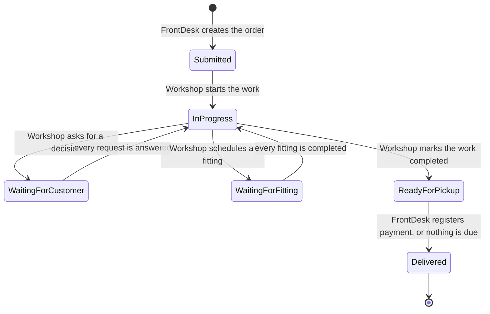

# Specification – TailorManager

## 1 The project in my own words

TailorManager is an order management system for tailoring businesses that handle new garment orders and repairs.

Employees can register customers and orders, track workshop progress, schedule fittings, communicate with customers, register payments and see the complete history of each order.

Delivered as a .NET Web API and a Blazor Server website for the employees, with PostgreSQL in Docker Compose, from a GitHub repo.

Categories: Core, API, Web, EF, Docker, Workflows, Docs, Mermaid

## 2 Requirements

Parts of the system:

- FrontDesk (registers incoming orders, handles payment and delivers completed orders)
- Workshop (processes orders, schedules fittings and communicates with customers)

Main flow (FrontDesk): an employee registers or finds a customer, creates an order with its work description and agreed price, submits it to the Workshop, and later registers payment, or confirms that nothing is due, before delivering the order.

Main flow (Workshop): an employee starts a submitted order, records the work, asks for written customer approval before changing the agreed work or price, schedules fittings when needed, and marks the order as ready for pickup when it is completed.

Core (MUST):

- (FrontDesk) Register a customer with name, phone number, email and address
- (FrontDesk) Find a customer by name, phone number or email
- (FrontDesk) Create an order for a new garment or a repair, with a work description and an agreed price
- (FrontDesk) Record the customer's initial agreement, with a reference to the signed intake form
- (FrontDesk) Record the customer's written agreement to a possible inspection fee
- (FrontDesk) Link an order to an earlier order from the same customer
- (FrontDesk → Workshop) A new order is submitted, so the Workshop sees the customer and the work
- (Workshop) List orders by status or customer, and open an order with its history
- (Workshop) Start a submitted order
- (Workshop) Record the work performed
- (Workshop) Ask the customer to approve a change to the agreed work or price
- (Workshop) Record the customer's written approval or rejection
- (Workshop) Schedule a fitting with an agreed date and time
- (Workshop) Record the result of a fitting
- (Workshop) Record incoming and outgoing email and SMS
- (Workshop → FrontDesk) Mark a completed order as ready for pickup
- (FrontDesk) Register a confirmed full payment, which delivers the order
- (FrontDesk) Deliver an order with nothing to pay

Rules:

- An order follows Submitted → InProgress → ReadyForPickup → Delivered, with WaitingForCustomer and WaitingForFitting as temporary states that return to InProgress when all outstanding requests or appointments of that type are resolved.
- An order in WaitingForCustomer has at least one pending customer decision request.
- An order in WaitingForFitting has at least one scheduled fitting that is not completed.
- Every change to the agreed work or price requires written customer approval, linked to the specific change request.
- A rejected change does not modify the agreed work or price.
- An approved price adjustment changes CurrentAgreedPrice only after the written approval is recorded.
- An order cannot be marked Delivered while it has an outstanding balance. Full payment must be registered first.
- An order with no outstanding balance can be marked Delivered without a payment.
- Incorrect payment amounts, duplicate transactions and invalid payment registrations are rejected without changing the order or its status. Core only accepts payments that are already confirmed outside Core.
- Linked orders must belong to the same customer.
- Reclamation work is free when valid reclamation grounds are established.
- An inspection fee can only be charged when the customer agreed to it in writing at intake, no valid reclamation grounds are established, and no other work is performed.
- Failed communication does not change the order status, but the failure is recorded in the history.
- An automated email notification request is raised when an order enters WaitingForCustomer or ReadyForPickup. Sending it happens outside Core.
- Delivered orders cannot be reopened. Reclamation work is registered as a new order linked to the original order.
- The order history is append-only: earlier activities are never overwritten or deleted.

Later / bonus (NOT NOW):

- Partial payments and deposits
- Order cancellation and cancellation fees
- Customer-facing order tracking
- Inventory and material management
- Accounting integration
- Direct email and SMS provider integrations
- Payment terminal integration
- Advanced reporting and business analytics

## 3 Flow


All relevant order activities are recorded in an append-only history: order creation, initial approvals, status changes, work notes, customer decisions, fittings, communication, price adjustments, notification requests and payments. The history references the detailed records instead of copying their contents.

### Order status

Every arrow is a move that is allowed, and becomes a function in §5. Moves without an arrow are not allowed.



## 4 Interface

| Type | Fields |
| --- | --- |
| Customer | Id (Guid), Name (string), Phone (string), Email (string), Address (string) |
| Order | Id (Guid), CustomerId (Guid), Type (OrderType), WorkDescription (string), InitialAgreedPrice (decimal), ApprovedPriceAdjustments (List<PriceAdjustment>), CurrentAgreedPrice (decimal, calculated), OutstandingBalance (decimal, calculated), Status (OrderStatus), CreatedAt (DateTimeOffset), RelatedOrderId (Guid?), History (List<OrderHistoryEntry>), Fittings (List<FittingAppointment>), CustomerDecisionRequests (List<CustomerDecisionRequest>), CustomerApprovals (List<CustomerApproval>), Communications (List<CommunicationEntry>), Payments (List<Payment>) |
| OrderHistoryEntry | Id (Guid), Type (ActivityType), OccurredAt (DateTimeOffset), ActorId (Guid?), ActorDisplayName (string?), RelatedEntityId (Guid?), Note (string?), FromStatus (OrderStatus?), ToStatus (OrderStatus?) |
| FittingAppointment | Id (Guid), ScheduledAt (DateTimeOffset), CompletedAt (DateTimeOffset?), Outcome (string?) |
| CustomerDecisionRequest | Id (Guid), ProposedWorkChange (string), ProposedPriceAdjustment (decimal?), Status (Pending / Approved / Rejected), ResponseCommunicationId (Guid?), RespondedAt (DateTimeOffset?) |
| CustomerApproval | Id (Guid), Scope (ApprovalScope), Method (ApprovalMethod), ApprovedAt (DateTimeOffset), RelatedDecisionRequestId (Guid?), CommunicationId (Guid?), DocumentReference (string?), ApprovedAmount (decimal?), ApprovedTerms (string?) |
| PriceAdjustment | Id (Guid), Description (string), Amount (decimal), ApprovedAt (DateTimeOffset), CustomerApprovalId (Guid) |
| CommunicationEntry | Id (Guid), Channel (Email / SMS), Direction (Incoming / Outgoing), Source (Manual / Automated / Customer), Content (string), Outcome (Sent / Received / Failed), OccurredAt (DateTimeOffset) |
| Payment | Id (Guid), Amount (decimal), ReceivedAt (DateTimeOffset), TransactionReference (string) |

| Enum | Values |
| --- | --- |
| OrderType | NewGarment, Repair |
| OrderStatus | Submitted, InProgress, WaitingForCustomer, WaitingForFitting, ReadyForPickup, Delivered |
| ActivityType | OrderCreated, InitialApprovalRecorded, StatusChanged, WorkNoteAdded, CustomerDecisionRequested, CustomerDecisionRecorded, FittingScheduled, FittingCompleted, CommunicationRecorded, PriceAdjusted, InspectionFeeAgreementRecorded, NotificationRequested, PaymentReceived |
| ApprovalMethod | SignedForm, Email, SMS |
| ApprovalScope | InitialOrder, WorkChange, InspectionFee |

Examples (the values the tests use):

- Customer: "Anna Hansen", "98765432", "anna@example.com", "Storgata 1, 0155 Oslo"
- Order: NewGarment, "Shorten the trousers by 3 cm", 450m
- Fitting: two days after the order is created, at 10:00
- Payment: 450m, "TX-1001"

```text
CustomerService

- Customer AddCustomer(string name, string phone, string email, string address)
  → the new customer
  Empty name, phone, email or address: ArgumentException
- IReadOnlyList<Customer> FindCustomers(string searchTerm)
  → customers whose name, phone or email matches
- Customer GetCustomer(Guid customerId)
  → the customer
  Unknown customer: CustomerNotFoundException

OrderService

- Order CreateOrder(Guid customerId, OrderType type, string workDescription, decimal agreedPrice, Guid? relatedOrderId)
  → a new order with status Submitted and a history entry
  Unknown customer: CustomerNotFoundException
  Negative price or empty work description: ArgumentException
  Unknown related order: OrderNotFoundException
  Related order belongs to another customer: InvalidOperationException
- CustomerApproval RecordInitialApproval(Guid orderId, ApprovalMethod method, string? documentReference)
  → records the customer's initial agreement
  Unknown order: OrderNotFoundException
  Invalid approval: ArgumentException
- CustomerApproval RecordInspectionFeeAgreement(Guid orderId, decimal amount, string documentReference)
  → records the written agreement to a possible inspection fee
  Unknown order: OrderNotFoundException
  Negative amount or missing document reference: ArgumentException
- IReadOnlyList<Order> ListOrders(OrderStatus? status, Guid? customerId)
  → the orders that match, all orders when both are null
- Order GetOrder(Guid orderId)
  → the order with its history
  Unknown order: OrderNotFoundException
- Order StartWork(Guid orderId)
  → status Submitted → InProgress, and a history entry
  Not Submitted: InvalidOrderStatusException
- Order AddWorkNote(Guid orderId, string note)
  → the note is added to the history
  Not InProgress: InvalidOrderStatusException
  Empty note: ArgumentException
- Order RequestCustomerDecision(Guid orderId, string proposedWorkChange, decimal? proposedPriceAdjustment)
  → a pending request, status WaitingForCustomer, and a notification request when entering WaitingForCustomer
  → can add further requests while already WaitingForCustomer
  Not InProgress or WaitingForCustomer: InvalidOrderStatusException
  Empty work change: ArgumentException
- Order RecordCustomerDecision(Guid orderId, Guid requestId, Guid communicationId, bool approved)
  → records the written response, creates a CustomerApproval when approved, applies an approved price adjustment
  → InProgress again when no request is pending
  No recorded written response: InvalidOperationException
- Order ScheduleFitting(Guid orderId, DateTimeOffset scheduledAt)
  → a fitting appointment, and status WaitingForFitting
  → can add further appointments while already WaitingForFitting
  Not InProgress or WaitingForFitting: InvalidOrderStatusException
  Invalid fitting date: ArgumentException
- Order CompleteFitting(Guid orderId, Guid fittingId, string outcome)
  → records the outcome
  → InProgress again when every fitting is completed
  Unknown fitting: KeyNotFoundException
  Not WaitingForFitting: InvalidOrderStatusException
- Order RecordCommunication(Guid orderId, CommunicationEntry communication)
  → records incoming or outgoing communication, and a history entry that references it
  Invalid communication: ArgumentException
- Order MarkReadyForPickup(Guid orderId)
  → status ReadyForPickup, a history entry and a notification request
  Not InProgress: InvalidOrderStatusException
- Order RegisterPayment(Guid orderId, decimal amount, string transactionReference)
  → records the full payment, adds history entries, and status Delivered
  Not ReadyForPickup: InvalidOrderStatusException
  Amount is not the outstanding balance: PaymentAmountMismatchException
  Transaction already registered: DuplicatePaymentException
- Order MarkDelivered(Guid orderId)
  → status Delivered when nothing is due
  Not ReadyForPickup: InvalidOrderStatusException
  Outstanding balance: PaymentRequiredException
```

Exceptions:

- CustomerNotFoundException and OrderNotFoundException derive from KeyNotFoundException.
- InvalidOrderStatusException, PaymentAmountMismatchException, DuplicatePaymentException and PaymentRequiredException derive from InvalidOperationException.

Calculated values:

- CurrentAgreedPrice = InitialAgreedPrice + the sum of approved price adjustments.
- OutstandingBalance = CurrentAgreedPrice − the sum of registered payments.
- InitialAgreedPrice may be zero for an order that is done free of charge.
- A price adjustment is only included in CurrentAgreedPrice after its CustomerApproval is recorded.

History:

- OrderHistoryEntry stores the activity type, the time, who did it, and a reference to the detailed record when there is one.
- RelatedEntityId references the fitting, decision request, approval, communication or payment.
- Communication content is stored in CommunicationEntry, not copied into the history.
- ActorDisplayName is the employee's first name and the first letter of the last name, like "Joakim B.".

Dependencies:

- ICustomerRepository and IOrderRepository, with in-memory fakes for the Core tests.
- TimeProvider (the clock, so the tests can set the time for CreatedAt, fittings and payments).
- Core receives confirmed payment data. Checking it against the payment terminal is a later integration.
- Core records communication and raises notification requests, but does not send email or SMS.
- No HTTP, frontend, database or external providers in Core.

Notes:

- Reclamation work is registered as a new order linked to the original order. It has no OrderType of its own yet.
- CustomerApproval can record an agreed inspection fee, but how the fee is assessed and applied is not clarified yet.
- OrderStatus holds one status at a time. An order that waits for a customer decision and a fitting at the same time is not defined yet (§6).
- Employees log in (§6). Each method that adds a history entry gets the logged-in employee as its last parameter in the Innlogging module. Until then, ActorId and ActorDisplayName are empty.

## 5 Test list

### (FrontDesk) Add a customer

- [x] Core: a new customer can be added with name, phone number, email and address

### (FrontDesk) Create an order

- [ ] Core: a new order for a garment or a repair is Submitted, with its agreed price and a history entry

### (Workshop) Start work

- [ ] Core: starting a submitted order sets InProgress and adds a history entry

### (Workshop) Record work

- [ ] Core: a work note on an order in progress is added to the history

### (Workshop) Mark ready for pickup

- [ ] Core: marking an order in progress ReadyForPickup adds a history entry and a notification request

### (FrontDesk) Register payment and deliver

- [ ] Core: a correct full payment is recorded, and the order is Delivered

### (FrontDesk) Deliver an order with nothing to pay

- [ ] Core: an order with no outstanding balance can be marked Delivered

### (FrontDesk) Create a free order

- [ ] Core: an order with price zero has no outstanding balance

### (FrontDesk) Find customers

- [ ] Core: searching by name, phone number or email returns only the matching customers

### (FrontDesk) Get a customer

- [ ] Core: a customer can be found by id

### (Workshop) List orders

- [ ] Core: orders can be listed, filtered by status and by customer

### (Workshop) Open an order

- [ ] Core: an order can be found by id, with its history

### (FrontDesk) Record the initial approval

- [ ] Core: the signed intake form is recorded as the initial approval

### (FrontDesk) Record an inspection fee agreement

- [ ] Core: a written inspection fee agreement is recorded with its amount and document reference

### (FrontDesk) Link to an earlier order

- [ ] Core: an order can be linked to an earlier order from the same customer

### (Workshop) Ask for a customer decision

- [ ] Core: asking for a change sets WaitingForCustomer and adds a notification request

### (Workshop) Ask for a second decision while waiting

- [ ] Core: a second request while WaitingForCustomer is added, and the order keeps waiting

### (Workshop) Approve a change

- [ ] Core: an approved change records the approval, and updates the agreed work and price

### (Workshop) Reject a change

- [ ] Core: a rejected change keeps the agreed work and price

### (Workshop) Resume after the customer decisions

- [ ] Core: the order returns to InProgress only when no request is pending

### (Workshop) Schedule a fitting

- [ ] Core: scheduling a fitting stores the date and time, and sets WaitingForFitting

### (Workshop) Complete a fitting

- [ ] Core: completing a fitting records its outcome

### (Workshop) Resume after the fittings

- [ ] Core: the order returns to InProgress only when every fitting is completed

### (Workshop) Record communication

- [ ] Core: incoming and outgoing email and SMS are added to the history

### (Workshop) Failed communication

- [ ] Core: a failed message is recorded without changing the order status

### Order history

- [ ] Core: the history is returned oldest first, references the detailed records, and earlier entries are never changed

### (Workshop) Start an order that is not submitted

- [ ] Core: starting fails when the order is not Submitted

### (Workshop) Work note on an order not in progress

- [ ] Core: adding a work note fails when the order is not InProgress

### (Workshop) Ready for pickup while waiting

- [ ] Core: marking ReadyForPickup fails while the order waits for a customer decision or a fitting

### (Workshop) Decision without a written response

- [ ] Core: recording a decision fails when no written response is recorded

### (Workshop) Complete a fitting on an order that is not waiting

- [ ] Core: completing a fitting fails when the order is not WaitingForFitting

### (FrontDesk) Pay before the order is ready

- [ ] Core: payment fails when the order is not ReadyForPickup

### (FrontDesk) Pay the wrong amount

- [ ] Core: a payment with the wrong amount fails and changes nothing

### (FrontDesk) Pay twice

- [ ] Core: a second payment, or the same transaction twice, fails and changes nothing

### (FrontDesk) Deliver with an outstanding balance

- [ ] Core: marking Delivered fails while there is an outstanding balance

### (FrontDesk) Link to another customer's order

- [ ] Core: linking fails when the earlier order belongs to another customer

### (FrontDesk) Add a customer with missing details

- [ ] Core: adding a customer fails when the name, phone number, email or address is empty

### (FrontDesk) Create an order with a negative price

- [ ] Core: creating an order fails when the price is negative

### (FrontDesk) Inspection fee with a negative amount

- [ ] Core: recording an inspection fee agreement fails when the amount is negative

### (Workshop) Empty work note

- [ ] Core: adding an empty work note fails

### (FrontDesk) Create an order for an unknown customer

- [ ] Core: creating an order fails when the customer does not exist

### (Workshop) Open an unknown order

- [ ] Core: opening an order fails when the id does not exist

Manual checks:

Later questions:

- [ ] Can an order wait for a customer decision and a fitting at the same time?
- [ ] When is reclamation work free, and who decides that the grounds are valid?
- [ ] When is the inspection fee charged, and how is it calculated?
- [ ] Which fitting dates are invalid: in the past, or outside opening hours?

## 6 Questions, assumptions and decisions

Decisions:

- Decision: a website for the employees, with Blazor Server and one menu per part (they work in the browser at the counter and in the workshop).
- Decision: an own Web API that the website calls (both parts share the orders, and payment, email and SMS can connect to it later).
- Decision: PostgreSQL with EF Core (orders, history and payments must survive a restart).
- Decision: Docker Compose for the API, the website and PostgreSQL (the same setup locally and in production).
- Decision: CI on GitHub Actions (every push is built and tested).
- Decision: employees log in with JWT, with one role per part, FrontDesk and Workshop (the history shows who did what).
- Decision: FrontDesk and Workshop are two parts of the same application, sharing the same orders and customers.
- Decision: a status flow for orders: Submitted, InProgress, WaitingForCustomer, WaitingForFitting, ReadyForPickup, Delivered (the diagram in §3).
- Decision: two types, Customer and Order, and an order points to its customer with CustomerId.
- Decision: rules use the clock through TimeProvider (fitting dates and timestamps).
- Decision: no email or SMS provider in the first version. Core raises notification requests, and sending them is Later.
- Decision: no payment terminal integration in the first version. Core only receives confirmed payments.
- Decision: new garments and repairs are the same Order type, separated by OrderType.
- Decision: a customer needs name, phone number, email address and postal address.
- Decision: every order has an append-only history of status changes, work notes, communication, fittings, approvals and payments.
- Decision: the agreed price is registered when the order is created.
- Decision: every change to the agreed work or price requires written customer approval, also when the price does not change.
- Decision: the initial approval is a signed form at intake.
- Decision: changes during the work can be approved by email or SMS, linked to the specific decision request.
- Decision: an order can have several customer decision requests and several fitting appointments at the same time.
- Decision: an order stays in its waiting status until every request or appointment of that type is resolved.
- Decision: linked orders must belong to the same customer.
- Decision: employees are shown in the history with their first name and the first letter of their last name.
- Decision: the first version supports one full payment per order. The model allows several payments later, but partial payments are not in scope.
- Decision: incorrect amounts and unconfirmed payments are rejected without changing the order or its status.
- Decision: reclamation work is a new order linked to the original order, with its own history.
- Decision: reclamation work is free when valid reclamation grounds are established.
- Decision: a possible inspection fee must be agreed in writing at intake.
- Decision: automated customer notifications are raised when an order enters WaitingForCustomer or ReadyForPickup.
- Decision: delivered orders cannot be reopened.
- Decision: order cancellation is not in the first version.
- Decision: the exceptions for unknown customers and orders derive from KeyNotFoundException, and the exceptions for rules derive from InvalidOperationException, so an API can map them to 404 and 409 later.
- Decision: Core has no dependencies on frontend, HTTP, database, email, SMS or payment terminal code.

Assumptions:

- Assumption: customers do not log in. Only employees use the system.
- Assumption: an order is either a new garment or a repair.
- Assumption: WaitingForCustomer and WaitingForFitting are temporary statuses.
- Assumption: a fitting needs a date and time, and an employee records when it is completed.
- Assumption: communication and written approvals belong to an order and are kept in its history.
- Assumption: each employee has a stable internal id in addition to the name shown in the history.

Questions:

- Question: does someone give employees access while the system runs (an admin), or are the users set up once? (the shop)
- Question: where should the system run in production? (the shop)
- Question: which details are required for a new garment order, and which for a repair? (the shop)
- Question: should the address be one field, or street, postal code and city? (the shop)
- Question: can an order wait for a customer decision and a fitting at the same time? (the shop)
- Question: should a reclamation be its own OrderType, or a kind of Repair? (me)
- Question: who decides that reclamation grounds are valid, and how is it documented? (the shop)
- Question: how is the inspection fee calculated? (the shop)
- Question: which payment terminal is used, and how does it report confirmed payments? (the shop)
- Question: which email and SMS providers should be used, and how are replies matched to the right order? (the shop)
- Question: should automated notifications use email, SMS or both? (the shop)
