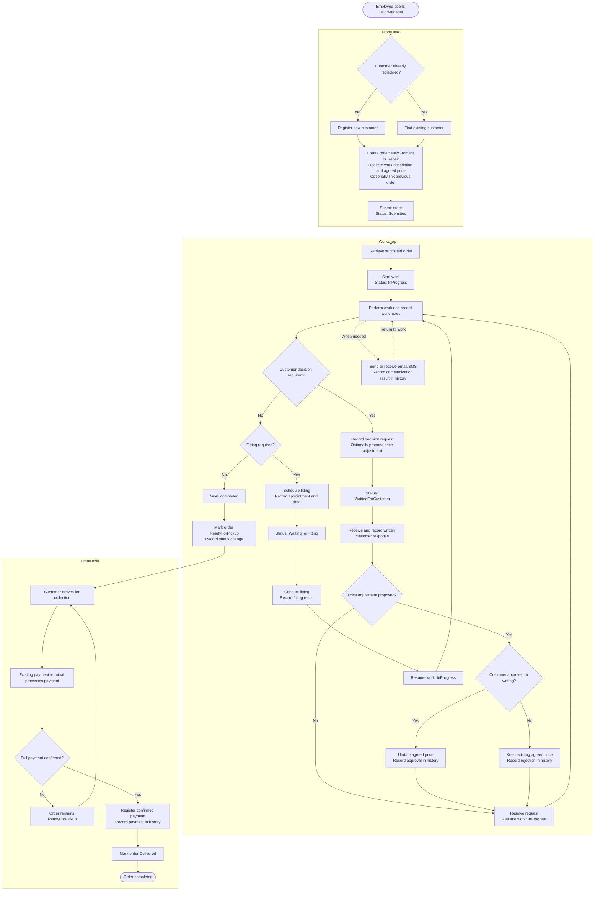

# Specification – TailorManager

## 1 The project in my own words

TailorManager is an order management system for tailoring businesses that handle new garment orders and repairs.
Employees can register customers and orders, track workshop progress, schedule fittings, communicate with customers, and register payments upon collection.
The system will have a .NET-based backend and an employee-facing interface, with frontend technology and deployment still undecided.

Parts: FrontDesk, Workshop, Core

## 2 Requirements

Parts of the system:
- FrontDesk (register incoming orders, handle payment and deliver completed orders)
- Workshop (process orders, schedule fittings and communicate with customers)

Main flow (FrontDesk): An employee registers a customer and an order, submits it to the Workshop, and later registers payment and delivers the order when the customer collects it.

Main flow (Workshop): An employee starts a submitted order, performs the work, pauses when waiting for customer decisions or fittings, communicates with the customer, and marks the order as ready for pickup when completed.

Core (MUST):

- (FrontDesk) Register a customer and create an order for a new garment or a repair, including its work description and initially agreed price. An order can optionally be linked to a previous order.
- (FrontDesk → Workshop) Submit an order so that the Workshop can access its customer information and work details.
- (Workshop) Start an order, record work performed, and update its status and history.
- (Workshop) Pause an order with the status WaitingForCustomer when a customer decision is required, record the written response, and resume work when the decision is resolved.
- (Workshop) Schedule fittings, pause an order with the status WaitingForFitting, and record fitting results before resuming work.
- (Workshop) Record incoming and outgoing customer communication and maintain a chronological history of all relevant order activities.
- (Workshop → FrontDesk) Mark a completed order as ReadyForPickup and make it available to FrontDesk.
- (FrontDesk) Register confirmed full payment and automatically change the order status to Delivered.

Rules:

- An order follows Submitted → InProgress → ReadyForPickup → Delivered, with WaitingForCustomer and WaitingForFitting as temporary states that return to InProgress.
- Work cannot be completed or an order marked ReadyForPickup while waiting for a customer decision or fitting.
- An order in WaitingForFitting must have a scheduled fitting date.
- An order has an initially agreed price when created. Changes to agreed work or price require written customer approval recorded in the order history.
- A proposed price adjustment does not affect the agreed price until the customer has approved it in writing.
- An order cannot be marked Delivered before full payment has been registered.
- Failed communication does not change the order status, but its failure is recorded in the history.
- Delivered orders cannot be reopened. Reclamation work is registered as a new order linked to the original order.
- Order history is append-only: previous activities are not overwritten or deleted.

Later / bonus (NOT NOW):

- Partial payments and deposits.
- Order cancellation and cancellation fees.
- Customer-facing order tracking.
- Inventory and material management.
- Accounting integration.
- Direct email and SMS provider integrations.
- Payment terminal integration.
- Advanced reporting and business analytics.

## 3 Flow

All relevant order activities are recorded in an append-only history.
This includes status changes, work notes, customer decisions, fittings,
communication events, price adjustments and payments.

## 4 Interface

Customer:
- Id (Guid)
- Name (string)
- Email (string?)
- Phone (string?)

OrderType:
- NewGarment
- Repair

OrderStatus:
- Submitted
- InProgress
- WaitingForCustomer
- WaitingForFitting
- ReadyForPickup
- Delivered

Order:
- Id (Guid)
- CustomerId (Guid)
- Type (OrderType)
- WorkDescription (string)
- InitialAgreedPrice (decimal)
- ApprovedPriceAdjustments (collection)
- CurrentAgreedPrice (calculated decimal)
- Status (OrderStatus)
- CreatedAt (DateTimeOffset)
- RelatedOrderId (Guid?)
- History (collection)
- Fittings (collection)
- CustomerDecisionRequests (collection)
- Communications (collection)
- Payments (collection)

OrderHistoryEntry:
- Id (Guid)
- Type (ActivityType)
- OccurredAt (DateTimeOffset)
- ActorId (Guid?)
- Relevant activity details

FittingAppointment:
- Id (Guid)
- ScheduledAt (DateTimeOffset)
- CompletedAt (DateTimeOffset?)
- Outcome (string?)

CustomerDecisionRequest:
- Id (Guid)
- Description (string)
- ProposedPriceAdjustment (decimal?)
- Status (Pending / Approved / Rejected / Answered)
- ResponseCommunicationId (Guid?)
- RespondedAt (DateTimeOffset?)

CommunicationEntry:
- Id (Guid)
- Channel (Email / SMS)
- Direction (Incoming / Outgoing)
- Source (Manual / Automated / Customer)
- Content (string)
- Outcome (Sent / Received / Failed)
- OccurredAt (DateTimeOffset)

Payment:
- Id (Guid)
- Amount (decimal)
- ReceivedAt (DateTimeOffset)
- TransactionReference (string)

CustomerService

- Customer AddCustomer(string name, string? email, string? phone)
  → the new customer
  Invalid name or contact details: ArgumentException

- Customer GetCustomer(Guid customerId)
  → the customer
  Missing customer: CustomerNotFoundException

OrderService

- Order CreateOrder(Guid customerId, OrderType type, string workDescription, decimal agreedPrice, Guid? relatedOrderId)
  → new order with status Submitted and initial history entry
  Missing customer: CustomerNotFoundException
  Invalid details or price: ArgumentException
  Invalid related order: OrderNotFoundException / InvalidOperationException

- IReadOnlyList<Order> ListOrders(OrderStatus? status, Guid? customerId)
  → matching orders

- Order GetOrder(Guid orderId)
  → order including its history
  Missing order: OrderNotFoundException

- Order StartWork(Guid orderId)
  → changes status from Submitted to InProgress
  Invalid status: InvalidOrderStatusException

- Order AddWorkNote(Guid orderId, string note)
  → records work performed
  Invalid status: InvalidOrderStatusException
  Invalid note: ArgumentException

- Order RequestCustomerDecision(Guid orderId, string description, decimal? proposedPriceAdjustment)
  → records the request and changes status to WaitingForCustomer
  Invalid status: InvalidOrderStatusException

- Order RecordCustomerDecision(Guid orderId, Guid requestId, Guid communicationId, bool approved)
  → records the written decision, applies an approved price adjustment, and resumes work
  Missing written response: InvalidOperationException

- Order ScheduleFitting(Guid orderId, DateTimeOffset scheduledAt)
  → creates a fitting appointment and changes status to WaitingForFitting
  Invalid status or fitting date: InvalidOperationException

- Order CompleteFitting(Guid orderId, Guid fittingId, string outcome)
  → records the fitting result and resumes work
  Invalid fitting or status: InvalidOperationException

- Order RecordCommunication(Guid orderId, CommunicationEntry communication)
  → records incoming or outgoing communication
  Invalid communication: ArgumentException

- Order MarkReadyForPickup(Guid orderId)
  → changes status to ReadyForPickup
  Invalid status: InvalidOrderStatusException

- Order RegisterPayment(Guid orderId, decimal amount, string transactionReference)
  → registers the payment, records history and changes status to Delivered
  Invalid status: InvalidOrderStatusException
  Incorrect amount: PaymentAmountMismatchException
  Duplicate transaction: DuplicatePaymentException

Dependencies:
- Repository interfaces for customers and orders, with in-memory implementations for tests.
- No HTTP, frontend, database or external provider dependencies in Core.

## 5 Test list

### Add a customer

- [ ] Core: AddCustomer_ValidDetails_ReturnsCustomer
- [ ] Core: AddCustomer_EmptyName_ThrowsArgumentException

### Create an order

- [ ] Core: CreateOrder_NewGarment_CreatesSubmittedOrder
- [ ] Core: CreateOrder_Repair_CreatesSubmittedOrder
- [ ] Core: CreateOrder_ValidPrice_StoresInitialAgreedPrice
- [ ] Core: CreateOrder_UnknownCustomer_ThrowsCustomerNotFoundException
- [ ] Core: CreateOrder_NegativePrice_ThrowsArgumentException
- [ ] Core: CreateOrder_LinkedOrder_StoresRelatedOrderId
- [ ] Core: CreateOrder_LinkToDifferentCustomerOrder_IsRejected

### List and find orders

- [ ] Core: ListOrders_NoFilter_ReturnsAllOrders
- [ ] Core: ListOrders_WithStatus_ReturnsMatchingOrders
- [ ] Core: ListOrders_WithCustomer_ReturnsMatchingOrders
- [ ] Core: GetOrder_ExistingOrder_ReturnsOrderWithHistory
- [ ] Core: GetOrder_UnknownId_ThrowsOrderNotFoundException

### Start work

- [ ] Core: StartWork_SubmittedOrder_ChangesStatusToInProgress
- [ ] Core: StartWork_SubmittedOrder_AddsHistoryEntry
- [ ] Core: StartWork_InvalidStatus_ThrowsInvalidOrderStatusException

### Record work

- [ ] Core: AddWorkNote_InProgressOrder_AddsHistoryEntry
- [ ] Core: AddWorkNote_InvalidStatus_ThrowsInvalidOrderStatusException
- [ ] Core: AddWorkNote_EmptyNote_ThrowsArgumentException

### Customer decisions

- [ ] Core: RequestCustomerDecision_InProgressOrder_ChangesStatusToWaitingForCustomer
- [ ] Core: RequestCustomerDecision_AddsHistoryEntry
- [ ] Core: RecordCustomerDecision_ApprovedRequest_RecordsApproval
- [ ] Core: RecordCustomerDecision_ApprovedPriceAdjustment_UpdatesAgreedPrice
- [ ] Core: RecordCustomerDecision_RejectedPriceAdjustment_KeepsOriginalPrice
- [ ] Core: RecordCustomerDecision_WithoutWrittenResponse_IsRejected
- [ ] Core: RecordCustomerDecision_ResolvedRequest_ResumesWork

### Fittings

- [ ] Core: ScheduleFitting_InProgressOrder_ChangesStatusToWaitingForFitting
- [ ] Core: ScheduleFitting_StoresScheduledDate
- [ ] Core: ScheduleFitting_AddsHistoryEntry
- [ ] Core: CompleteFitting_ValidFitting_RecordsOutcome
- [ ] Core: CompleteFitting_CompletedFitting_ResumesWork
- [ ] Core: CompleteFitting_InvalidStatus_ThrowsInvalidOrderStatusException

### Communication

- [ ] Core: RecordCommunication_OutgoingEmail_AddsHistoryEntry
- [ ] Core: RecordCommunication_OutgoingSms_AddsHistoryEntry
- [ ] Core: RecordCommunication_IncomingMessage_AddsHistoryEntry
- [ ] Core: RecordCommunication_FailedMessage_RecordsFailureWithoutChangingStatus

### Mark ready for pickup

- [ ] Core: MarkReadyForPickup_InProgressOrder_ChangesStatus
- [ ] Core: MarkReadyForPickup_AddsHistoryEntry
- [ ] Core: MarkReadyForPickup_WaitingForCustomer_IsRejected
- [ ] Core: MarkReadyForPickup_WaitingForFitting_IsRejected

### Register payment and deliver order

- [ ] Core: RegisterPayment_ReadyOrderAndCorrectAmount_RecordsPayment
- [ ] Core: RegisterPayment_ReadyOrderAndCorrectAmount_ChangesStatusToDelivered
- [ ] Core: RegisterPayment_ReadyOrderAndCorrectAmount_AddsHistoryEntries
- [ ] Core: RegisterPayment_IncorrectAmount_ThrowsPaymentAmountMismatchException
- [ ] Core: RegisterPayment_NotReady_ThrowsInvalidOrderStatusException
- [ ] Core: RegisterPayment_DuplicateTransaction_ThrowsDuplicatePaymentException
- [ ] Core: RegisterPayment_InvalidPayment_DoesNotChangeOrderStatus

### Order history

- [ ] Core: OrderHistory_ContainsAllRecordedActivities
- [ ] Core: OrderHistory_EntriesAreReturnedChronologically
- [ ] Core: OrderHistory_PreviousEntriesAreNotOverwritten

## 6 Questions, assumptions and decisions

Decisions:

- Decision: FrontDesk and Workshop are two work areas within the same application, sharing the same orders and customer information (this avoids unnecessary separation of the business workflow).
- Decision: New garments and repairs are represented as the same Order entity, differentiated by OrderType (both represent paid work performed by the workshop).
- Decision: Every order maintains an append-only history of relevant activities, including status changes, work notes, customer communication, fittings, approvals and payments (this preserves the complete order history).
- Decision: The initially agreed price is registered when the order is created. Changes to agreed work or price require written customer approval recorded in the order history (this provides traceability of customer consent).
- Decision: The first version supports one full payment per order. The data model should allow multiple payments in the future, but partial payment functionality is not part of the initial scope.
- Decision: Delivered orders cannot be reopened. Reclamation work is registered as a new order linked to the original order (this preserves the original order history).
- Decision: Order cancellation is outside the initial scope (cancellation requires additional rules for approval, fees and payment handling).
- Decision: The Core has no direct dependencies on frontend, HTTP, database, email, SMS or payment terminal implementations (this keeps business logic independently testable).

Assumptions:

- Assumption: Customers do not log in to TailorManager. All operations are performed by employees.
- Assumption: An order can be either a new garment order or a repair order.
- Assumption: WaitingForCustomer and WaitingForFitting are temporary statuses. Both return to InProgress when their respective conditions are resolved.
- Assumption: An order can have multiple fitting appointments throughout its lifecycle.
- Assumption: Customer communication and written approvals are associated with the relevant order and preserved in its history.
- Assumption: Dummy data will represent plausible tailoring orders and repairs, without claiming to define every real business requirement.
- Assumption: The frontend will be employee-facing, but its technology and hosting model remain undecided.

Questions:

- Question: Which details are required for a new garment order, and which are required for a repair order?
- Question: Which customer details are mandatory when registering a customer?
- Question: Which forms of written customer approval are accepted (email, SMS or other documented forms)?
- Question: How should customer approval be represented and linked to a proposed work or price change?
- Question: Can the agreed price be changed after an order has entered WaitingForCustomer, and must the customer approve every change to the agreed work?
- Question: What information must be recorded for each fitting appointment, including its outcome?
- Question: Can multiple fitting appointments or customer decision requests be active on the same order?
- Question: Must linked orders always belong to the same customer?
- Question: How should employees be identified in the order history?
- Question: Which existing payment terminal solution will be integrated, and how does it expose confirmed payment information?
- Question: What should happen when a payment is received for an incorrect amount or a payment confirmation cannot be verified?
- Question: Should a reclamation always be free, or can it result in a new paid repair order?
- Question: Which order status changes should trigger automated customer notifications?
- Question: Which email and SMS providers should be used, and how should incoming replies be associated with the correct order?
